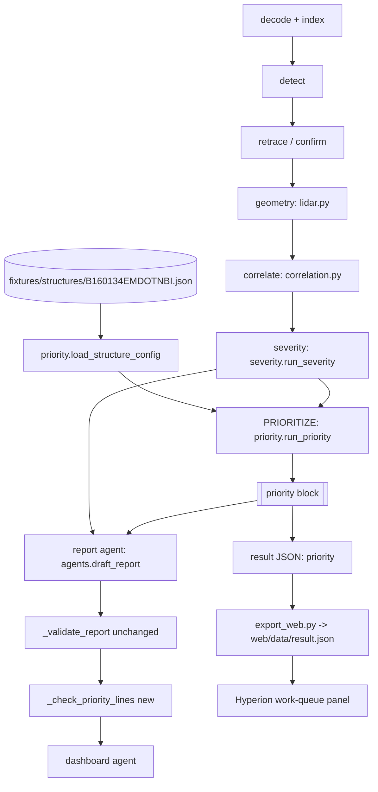

# Design Document: Risk-Based Maintenance Prioritization

## Overview

This feature adds one deterministic pipeline step, **PRIORITIZE**, between SEVERITY (step 7) and the REPORT agent (step 8). It groups the scored detections of a mission by bridge element, computes a bounded, monotone priority score per element from fixed rules, ranks the elements into a work queue, and writes the result as a top-level `priority` block in the result JSON. The report agent may narrate the block, Hyperion shows it in a new work-queue panel, and nothing downstream recomputes it.

The design keeps "code enforces, models explain":

- Every score, rank, factor and weight is computed in `pipeline/priority.py` from named constants. No prompt carries a threshold or a weight.
- `agents._validate_report` is not touched. A second, separate deterministic check in `agents.py` (`_check_priority_lines`) drops LLM priority lines whose stated rank, score or worst state disagrees with the block (Req 9.5).
- The deterministic fallback narrative gains priority lines that `_validate_report` always keeps (Req 9.6 to 9.8).
- Unreal data stays labelled: `is_illustrative` (structure config not verified against NBI), `is_simulated` (Isaac Sim missions), `has_ground_truth`, `needs_identification` (generic `sonar_anomaly`) and `ground_truth_only`.
- `priority.py` and its tests are standard library only. Hypothesis is optional and imported inside a `try` in the test module.

### Research findings that shape the design

- **NBI items.** The FHWA [Recording and Coding Guide for the Structure Inventory and Appraisal of the Nation's Bridges](https://www.fhwa.dot.gov/bridge/mtguide.pdf) defines Item 8 (structure number, 15 characters), Item 27 (year built, 4 digits), Item 29 (ADT, 6 digits) and Item 113 (scour-critical bridges, codes `0`-`9`, `N`, `T`, `U`). These give the field ranges in Requirement 1.2 and the source comments on the config constants.
- **Item 113 semantics.** FHWA's [Item 113 coding revision](https://www.fhwa.dot.gov/engineering/hydraulics/policymemo/revguide.cfm) and its [scour countermeasure memo](https://www.fhwa.dot.gov/engineering/hydraulics/policymemo/coescour.cfm) describe Item 113 as a structure-level rating of scour vulnerability that the bridge owner assigns. FHWA defines a scour-critical bridge as one whose foundation elements are judged unstable for the calculated or observed scour conditions ([Plan of Action guidance](https://www.fhwa.dot.gov/engineering/hydraulics/bridgehyd/poappt.cfm)). The code says nothing about which element is at risk. That is why the per-element `scour_critical` flag exists separately in the config.
- **Condition states.** The AASHTO Manual for Bridge Element Inspection defines four condition states (CS1 good, CS2 fair, CS3 poor, CS4 severe). `severity.STATES` already uses this order. The priority weights follow it, and the point values are project judgement.
- **Scour risk.** FHWA HEC-18 (*Evaluating Scour at Bridges*) names scour as the most common cause of bridge failure over water. This supports weighting scour-critical elements above other underwater elements. The weight itself is project judgement.

Content from these sources was rephrased for compliance with licensing restrictions.

### Key design decisions

| # | Decision | Rationale |
|---|---|---|
| D1 | The score is a **sum of seven non-negative, individually monotone components**, then clamped to [0, 100]. There is no averaging and no subtraction. | Each monotonicity property (Req 5) follows from per-component monotonicity. A sum with no averaging makes added-defect monotonicity (Req 5.6) hold by construction. |
| D2 | Arithmetic runs in **integer centi-points** (1 point = `CENTI_PER_POINT` = 100 centi). Saturating curves use integer floor division. The written score is `score_centi / CENTI_PER_POINT`. | This removes float rounding from ranking. Two written scores are equal exactly when their centi values are equal, so ranking by centi is ranking by the written value (Req 6.1). Floor of a non-decreasing function is non-decreasing, so monotonicity survives the rounding. |
| D3 | Change status points: `existing` 0 < `new` 1 < `worsening` 4. | A `new` defect has no prior record and has not yet been assessed by an engineer, so it deserves a small lift over one already in the prior-cycle record. `worsening` is measured growth and ranks highest. A missing status is scored as `new` (Req 3.11), so the change from missing to `worsening` never lowers the score (Req 5.3). |
| D4 | **Neutral factors contribute 0 points.** Neutral ADT gives the same contribution as ADT 0, neutral age the same as age 0, and neutral location flags are `false`. | This matches the glossary: a neutral factor neither raises nor lowers the score relative to the documented baseline. The baseline is "this factor adds nothing". The warning in the block makes the missing data visible, so the lower score is never silent. |
| D5 | The structure-level `scour_critical_code` (NBI Item 113) is **provenance only**. It is loaded, validated and shown, and it never changes an element flag or a score. | Req 3.3 lists the score inputs and does not include the code. Req 3.5 says an element is scour-critical only when its config entry says so. Item 113 rates the whole structure and does not say which element is at risk. |
| D6 | Exposure (ADT, age) is additive and identical for every element of one structure. | Within one bridge it does not change the order. Across bridges it shifts absolute scores, which is what the comparability user story (Req 4) asks for. A multiplicative form would also be monotone but makes the breakdown harder to read. |
| D7 | `run_priority` accepts both `Detection` objects and detection dicts (the `to_dict()` shape). | The pipeline passes `Detection` objects. Tests and filler records can be dicts. `Detection` has no `is_filler` field today, and adding one to the schema is not required by this feature. |
| D8 | `is_simulated` comes from the module constant `ALL_MISSIONS_SIMULATED = True`, passed by the entry points. | Every mission the project decodes (`fixtures/`, `sample_data/`, and the full bags they were trimmed from) is Isaac Sim + ArduPilot SITL (product steering). A future real-data path must pass `is_simulated=False` explicitly. |
| D9 | The structure config lives at `fixtures/structures/B160134EMDOTNBI.json`. `config.json` gains the top-level key `structure_config`. `run_bag.py` gains `--structure-config PATH`. | `fixtures/` already holds shared reference data (`element_map.json`). Naming the file by structure number allows more bridges later. A top-level key is used because the config applies in mock and live mode alike. |
| D10 | The Req 9.5 check is a separate function `_check_priority_lines` that runs **after** `_validate_report` on the lines it kept. | `_validate_report` stays byte-for-byte unchanged (steering rule 2). The new check only removes lines and never adds any back. |

## Architecture



### Flow placement

- `pipeline/orchestrator.py` (`run.py` / mock mode): after `severity.run_severity(detections)`, call `priority.load_structure_config(structure_config)` and `priority.run_priority(detections, factors, is_simulated=priority.ALL_MISSIONS_SIMULATED)`. Pass a deep copy of the block to `agents.draft_report(detections, priority=...)`. Add `"priority": block` to the returned dict.
- `run_bag.py`: the same calls, at the same point (after `severity.run_severity`, before `agents.draft_report`), with the config path from `--structure-config` or the `config.json` default.
- `PIPELINE.md` renumbers the flow: 7 CORRELATE + SEVERITY, **8 PRIORITIZE**, 9 REPORT, 10 DASHBOARD.

### Module ownership

| Module | Change |
|---|---|
| `pipeline/priority.py` (new) | Config loading/validation, scoring, ranking, block assembly. Owns every priority constant. |
| `pipeline/config.py` | `load_config` resolves a relative top-level `structure_config` path against the repo root. |
| `pipeline/orchestrator.py` | New `structure_config` parameter. Calls the PRIORITIZE step. Adds `priority` to the result. |
| `run.py` | Passes `cfg["structure_config"]` to `run_pipeline`. |
| `run_bag.py` | New `--structure-config` flag. Default from `config.json`. Calls the PRIORITIZE step. Adds `priority` to the result. |
| `pipeline/agents.py` | `draft_report(detections, priority=None)`; priority data in the structured input; `_deterministic_priority_lines`; `_check_priority_lines`. `_validate_report` unchanged. |
| `export_web.py` | Extract `export_result(result, web_data)` (verbatim copy, `priority` included) so it can be tested without numpy. |
| `web/index.html`, `web/app.js`, `web/style.css` | New work-queue panel. |
| `fixtures/structures/B160134EMDOTNBI.json` (new) | Craigie Drawbridge structure config. |
| `config.json` | `"structure_config": "fixtures/structures/B160134EMDOTNBI.json"`. |
| `tests/test_priority.py` (new) | Unit, seeded-random and Hypothesis property tests. |
| Docs | `ARCHITECTURE.md`, `PIPELINE.md`, `DATA_INPUTS.md`, `README.md` (Req 12). |

## Components and Interfaces

### `pipeline/priority.py`

Module docstring: "PRIORITIZE (pipeline step 8): risk-based maintenance prioritization. Owns the structure config loader, the element score, the work-queue order and the priority block. Code enforces; the report agent only narrates the block."

#### Constants (all UPPER_CASE, each with a source comment)

```python
RULES_VERSION = "priority-rules@1"      # project judgement: bump when any constant below changes

SCORE_MIN = 0                            # project judgement: fixed 0-100 scale
SCORE_MAX = 100                          # project judgement: fixed 0-100 scale
CENTI_PER_POINT = 100                    # project judgement: scores written with 2 decimals

UNASSIGNED_ELEMENT = "UNASSIGNED"        # project judgement: reserved id for detections with no element

# AASHTO MBE condition states CS1-CS4 (good < fair < poor < severe); points are project judgement.
WORST_STATE_POINTS = {"good": 0, "fair": 10, "poor": 25, "severe": 40}
# AASHTO MBE condition-state order; per-defect points are project judgement.
DEFECT_STATE_POINTS = {"good": 1, "fair": 2, "poor": 4, "severe": 6}
DEFECT_LOAD_CAP_POINTS = 20              # project judgement: many small defects never outrank one severe defect alone
# Change vs prior cycle (correlation.tag_change_status); points are project judgement (decision D3).
CHANGE_POINTS = {"existing": 0, "new": 1, "worsening": 4}
CHANGE_CAP_POINTS = 10                   # project judgement
UNDERWATER_POINTS = 8                    # project judgement: underwater elements are inspected less often and harder to reach
SCOUR_CRITICAL_POINTS = 12               # FHWA HEC-18 (scour is the leading cause of failure over water); value is project judgement
ADT_POINTS_MAX = 10                      # project judgement
ADT_HALF_SATURATION_VPD = 10_000         # project judgement: ADT at which the ADT component reaches half of ADT_POINTS_MAX
AGE_POINTS_MAX = 10                      # project judgement
AGE_FULL_YEARS = 100                     # project judgement: age component saturates at 100 years

FALLBACK_SEVERITY = "fair"               # Req 3.10; matches severity.py "any detection starts at fair"
FALLBACK_CHANGE_STATUS = "new"           # Req 3.11

# Structure-config field ranges.
STRUCTURE_NUMBER_MAX_LEN = 15            # NBI Item 8 width
STRUCTURE_NAME_MAX_LEN = 200             # project judgement
YEAR_MIN, YEAR_MAX = 1800, 2100          # NBI Item 27 is a 4-digit year; bounds are project judgement
ADT_MIN, ADT_MAX = 0, 999_999            # NBI Item 29 is 6 digits
AGE_MAX_YEARS = YEAR_MAX - YEAR_MIN      # 300: largest age the valid year ranges allow
SCOUR_CODES = ("0","1","2","3","4","5","6","7","8","9","N","T","U")   # NBI Item 113 code set
SOURCE_MAX_LEN = 2000                    # project judgement
SOURCE_VERSION_MAX_LEN = 100             # project judgement

ALL_MISSIONS_SIMULATED = True            # product steering: every shipped mission is Isaac Sim + ArduPilot SITL
FACTOR_ORDER = ("worst_condition_state", "defect_load", "change_status",
                "underwater", "scour_critical", "adt", "structure_age")   # fixed breakdown order
```

The largest pre-clamp sum is 40 + 20 + 10 + 8 + 12 + 10 + 10 = 110, so the `SCORE_MAX` clamp can trigger. Every component is at least 0, so the `SCORE_MIN` clamp cannot trigger with these constants. It is kept as a defensive guard, recorded in the rule trail if it ever fires (Req 4.6).

#### Public functions

```python
def load_structure_config(path: str | None) -> StructureFactors:
    """Read and validate a structure config. Never raises for a bad or missing
    file; returns neutral factors plus warnings instead (Req 2)."""

def run_priority(detections: Iterable[Detection | Mapping],
                 factors: StructureFactors,
                 *, is_simulated: bool = ALL_MISSIONS_SIMULATED) -> dict:
    """Step 8: score, rank and return the priority block (Req 3-8).
    Pure: does not mutate detections or factors; stdlib only; no network."""

def queue_sort_key(entry: dict) -> tuple:
    """Tie_Break_Order key: (-score_centi, -worst_rank, -scored_count, element_id)."""
```

#### Internal functions

| Function | Purpose |
|---|---|
| `_view(rec) -> _DetView` | Normalizes a `Detection` or dict to `detection_id`, `element_id`, `platform`, `cls`, `model_version`, `severity`, `change_status`, `is_filler`. Reads `cls` from `cls` or `class`. `is_filler` is true only when the attribute or key `is True`. |
| `_group(views) -> (groups, excluded)` | Splits out fillers (`excluded`, reason `filler`). Groups scored views by `element_id or UNASSIGNED_ELEMENT`. |
| `_score_element(element_id, views, factors) -> dict` | Computes the components in centi-points, the breakdown, the rule trail and the flags for one element. |
| `_ladder_index(state)` | Index in `severity.STATES`, reused so the order has one source. |
| `_adt_centi(adt)`, `_age_centi(age)` | Saturating integer curves (see below). |
| `_factor_warnings(factors)` | Warnings for out-of-range factors passed directly to `run_priority` (Req 4.7). |

#### Scoring formula (all integer centi-points)

For element *e* with scored detections *S* (fillers removed), effective states *s(d)* and statuses *c(d)* after fallback substitution:

| Component | Centi-points | Input written to the breakdown | Constant |
|---|---|---|---|
| worst condition state | `WORST_STATE_POINTS[max(s(d))] * CENTI` | worst state string | `WORST_STATE_POINTS` |
| defect load | `min(sum(DEFECT_STATE_POINTS[s(d)]), DEFECT_LOAD_CAP_POINTS) * CENTI` | `{state: count}` for all four states | `DEFECT_STATE_POINTS` |
| change status | `min(sum(CHANGE_POINTS[c(d)]), CHANGE_CAP_POINTS) * CENTI` | `{status: count}` for all three statuses | `CHANGE_POINTS` |
| underwater | `UNDERWATER_POINTS * CENTI` if `config_underwater or any(d.platform == "rov")`, else 0 | `{"config": bool, "rov_detection": bool}` | `UNDERWATER_POINTS` |
| scour critical | `SCOUR_CRITICAL_POINTS * CENTI` if config `scour_critical`, else 0 | bool | `SCOUR_CRITICAL_POINTS` |
| ADT | `(ADT_POINTS_MAX * CENTI * a) // (a + ADT_HALF_SATURATION_VPD)`; 0 if neutral | ADT int or `null` | `ADT_POINTS_MAX` |
| structure age | `(AGE_POINTS_MAX * CENTI * min(g, AGE_FULL_YEARS)) // AGE_FULL_YEARS`; 0 if neutral | age int or `null` | `AGE_POINTS_MAX` |

`CENTI` is `CENTI_PER_POINT`. `raw_centi = sum(components)`, `score_centi = min(max(raw_centi, SCORE_MIN * CENTI), SCORE_MAX * CENTI)`. Written values: `contribution = component_centi / CENTI_PER_POINT`, `score = score_centi / CENTI_PER_POINT`.

The only literals in the arithmetic are 0 and 1 (Req 3.7). For the Unassigned_Element, `config_underwater` and `config_scour_critical` are always false (Req 3.12). A ROV detection can still make it underwater (Req 3.4).

**Worked example.** `canal_wall_E` on the drone+ROV sample with the GT detector: one severe and three poor detections, all `new` (no prior cycle), not underwater, not scour-critical, illustrative ADT 30 000 and age 116. The components are worst 40.00, load 6 + 3 × 4 = 18.00, change 4 × 1 = 4.00, underwater 0, scour 0, ADT (1000 × 30000) // 40000 = 750 centi = 7.50, age capped at 100 years = 10.00. Total 79.50.

#### Why the properties hold

- **Bounds (Req 4).** Every component is a non-negative integer. The final clamp forces `score_centi` into `[SCORE_MIN * CENTI, SCORE_MAX * CENTI]`. The ADT curve is below `ADT_POINTS_MAX * CENTI` for every finite `a >= 0`, and the age term is capped by `min(g, AGE_FULL_YEARS)`, so out-of-range factors (Req 4.7) are still finite and bounded. Integer arithmetic gives no NaN or infinity.
- **Severity / worst-state monotonicity (Req 5.1, 5.2).** `WORST_STATE_POINTS` and `DEFECT_STATE_POINTS` are non-decreasing in `severity.STATES` order (pinned by a unit test). Raising one `s(d)` cannot lower `max`, cannot lower the sum, and `min(·, cap)` is non-decreasing. Other components do not read `s`.
- **Change monotonicity (Req 5.3).** `CHANGE_POINTS["worsening"]` is greater than or equal to both other values, and a missing status is scored as `new`.
- **Location monotonicity (Req 5.4).** The flag components are `0` or a positive constant, and `or` with a true flag stays true.
- **Exposure monotonicity (Req 5.5).** `K·a/(a+h)` is increasing in `a` for `h > 0`. Integer floor of a non-decreasing function is non-decreasing. The same holds for `min(g, cap)`. A valid raised age (earlier `year_built` or later `assessment_year`) keeps `assessment_year >= year_built`, so the factor stays non-neutral.
- **Added-defect monotonicity (Req 5.6).** Adding a scored detection adds non-negative terms to both sums, cannot lower `max`, and can only turn `underwater` on. There is no averaging.
- **Filler neutrality (Req 5.7).** Fillers are removed in `_group` before any component reads the list.
- **Clamp.** `min(max(x, lo), hi)` is non-decreasing in `x`, so every monotonicity result above survives the clamp.
- **Order independence (Req 6.6, 6.7).** Components use `sum`, `max`, `any` and counts, which are commutative. `detection_ids`, `sonar_anomaly_ids` and excluded IDs are sorted. Rule-trail substitution notes are sorted by `detection_id`. Config elements are only looked up by key, and loader warnings over elements iterate in sorted id order.
- **Total order (Req 6.1, 6.8).** `queue_sort_key` ends with `element_id`, and element ids are unique, so the key is injective and the order is total. `score_centi` maps one-to-one to the written `score`.

### Structure config loader

`load_structure_config(path)` parses with `json.loads(text, object_pairs_hook=_reject_duplicates)` so that a duplicate key is detected rather than silently overwritten. It then validates in a fixed order and emits warnings in this order (Req 2.9):

1. **File level** (returns immediately with all-neutral factors and exactly one warning): path is `None` or the file is missing or unreadable (Req 2.2); invalid JSON; top-level value is not an object (Req 2.3).
2. **Factor fields**, in the order `year_built`, `assessment_year`, `adt`, `scour_critical_code`: missing, wrong type, out of range or duplicated → `None` (neutral) and one warning each (Req 2.4). `type(v) is int` is required for integer fields, so `True` is rejected.
3. **Identity fields**, in the order `structure_number`, `structure_name`: invalid → `None` and one warning each (Req 8.11).
4. **Provenance fields**, in the order `is_illustrative`, `source`, `source_version`: any invalid → `is_illustrative = True` in the factors and one warning per invalid field (Req 2.7). An invalid `source` or `source_version` is stored as `None`.
5. **Elements**: `elements` missing or not an object → one warning and all flags false. Otherwise iterate element ids in sorted code-point order. Empty id, the reserved id `UNASSIGNED`, or a duplicated id → warning and the entry is ignored (both flags false). For each kept id, check the flags in the order `underwater`, `scour_critical`: a flag that is missing or not a bool becomes false and gets one warning naming the id and the flag (Req 2.5). Extra keys in an entry → one warning per extra key, sorted, and the key is ignored.
6. **Age consistency**: `assessment_year < year_built` → `age_years = None` and one warning naming both fields (Req 2.6). Both years are kept.

Age is `assessment_year - year_built`. It is never derived from the system clock (Req 2.8).

### Report agent changes (`pipeline/agents.py`)

```python
def draft_report(detections: list[Detection], priority: dict | None = None) -> dict
def _deterministic_priority_lines(priority: dict) -> list[str]
def _check_priority_lines(lines: list[str], priority: dict) -> tuple[list[str], list[str]]
```

- **Structured input.** When `priority` is given, `_structured_for_report` adds `"priority": {"work_queue": [{rank, element_id, score, worst_condition_state, detection_ids, needs_identification, has_ground_truth}], "is_illustrative", "is_simulated", "ground_truth_only"}`. The user prompt adds a format instruction only: "If you describe the work queue, write one line per element in the form `Priority rank N: element E, score S, worst condition state W [D-...]`, copying the values from the priority data." There is no threshold or weight in the prompt.
- **Deterministic fallback.** `_deterministic_report(detections)` is unchanged. `draft_report` appends `_deterministic_priority_lines(priority)` to the fallback narrative. For the first `PRIORITY_FALLBACK_TOP_N = 5` entries (Req 9.6) it writes:
  `Priority rank {rank}: element {element_id}, score {score:.2f}, worst condition state {state} [D-…] [D-…].`
  Each line cites up to `PRIORITY_FALLBACK_MAX_IDS = 3` (project judgement: keeps lines readable) of the entry's sorted `detection_ids`. Every entry has at least one id, so `_validate_report` keeps the line. An empty queue gives `Maintenance priority: no elements are queued.`, which contains no digits (Req 9.8).
- **Priority-line check (Req 9.3, 9.5).** This runs on the lines that `_validate_report` kept, only for LLM text. A line counts as a priority line when it matches `PRIORITY_LINE_RE = r"\b(priority|rank(?:ed)?|score[ds]?)\b"` (case-insensitive). For each priority line:
  1. Map each cited id to its work-queue element. If any cited id is in no entry (for example a filler), or the ids span more than one element → drop.
  2. If the line names any other work-queue `element_id` as a whole word → drop.
  3. Extract the stated rank (`RANK_CLAIM_RE = r"\brank(?:ed)?\s*(?:#|no\.?)?\s*(\d+)"`), score (`SCORE_CLAIM_RE = r"\bscored?\s*(?:of|is|=|:)?\s*(\d+(?:\.\d+)?)"`) and worst state (`STATE_CLAIM_RE = r"\bworst(?:\s+condition)?(?:\s+state)?\s*(?:is|of|=|:)?\s*(good|fair|poor|severe)\b"`). A stated rank must equal `rank`. A stated score must satisfy `abs(v - score) <= SCORE_CLAIM_TOLERANCE` (= 0.005, half of the last written decimal, so "79.5" matches 79.50). A stated state must equal `worst_condition_state`. Any mismatch → drop.
  
  Dropped lines are appended to the report's `dropped` list. If nothing is left after both checks, the existing "all LLM claims failed validation" fallback path is used. The check never edits or adds a line, and it never modifies `priority`.
- **Block immutability (Req 9.9).** The orchestrator and `run_bag.py` pass `copy.deepcopy(block)` to `draft_report` and write the original to the result JSON.

### Web export (`export_web.py`)

`main` currently writes `result.json` verbatim. The design extracts that into `export_result(result: dict, web_data: Path) -> None` (no numpy import), which `main` calls. The `priority` object passes through unchanged (Req 10.1).

### Hyperion work-queue panel

Placement: Tab 1 "Bridge Defects", a new `<section class="panel queue-panel" id="queue-panel">` directly after "Per-element condition" and before "Engineering assessment". The help text says the order and scores come from fixed rules in `pipeline/priority.py`.

```
<h2>Maintenance work queue</h2>
<div id="queue-labels"></div>       structure name, number, source, source version ("not provided" if empty);
                                    badges: Illustrative structure data (not verified against NBI) /
                                    Simulated mission data / ground-truth-only label
<div id="queue-warnings"></div>     every warning, full text
<table id="queue-table">            rank | element | score | worst state | detections | labels
<div id="queue-detail"></div>       factor breakdown table, rule trail, detection id list
<div id="queue-excluded"></div>     excluded detection id + reason
```

`renderWorkQueue(priority)` in `app.js`:

- Iterates `priority.work_queue` in array order. It never calls `sort`, never computes a score, and never re-ranks (Req 10.2). The Python side guarantees ascending `rank`.
- Shows `score` with `fmtNum(score, 2)` (formatting only) and `detection_ids.length`.
- Row badges: "Needs identification (generic sonar anomaly)" when `needs_identification`, and "Ground truth (not model output)" when `has_ground_truth` (Req 10.7).
- A click on a row replaces `#queue-detail` content (`innerHTML` assignment), so exactly one element's details are shown (Req 10.3). Clicking a detection id opens the existing `openDetail(DETS_BY_ID[id])`.
- No block → "No priority data for this mission" and no rows (Req 10.9). Empty queue → "No elements have scored detections in this mission", while the structure fields and labels still render (Req 10.11).
- `ground_truth_only` → label "Every scored detection in this run is ground truth, not model output" (Req 10.12).
- All strings go through the existing `esc()`. No new third-party script and no build step (Req 10.10).

`style.css` gains `.queue-panel` table and row-selection styles, reusing the existing `.badge` classes (`sim`, `filler`).

### Entry points and config

- `config.json`: `"structure_config": "fixtures/structures/B160134EMDOTNBI.json"` (top level).
- `pipeline/config.load_config`: if `cfg.get("structure_config")` is relative, resolve it against `HERE`.
- `run.py`: `run_pipeline(..., structure_config=cfg.get("structure_config"))`.
- `run_bag.py`: `ap.add_argument("--structure-config", default=None, help="per-bridge structure config JSON (default: config.json structure_config)")`. When it is omitted, read `cfgmod.load_config().get("structure_config")` (Req 1.9, 1.10).

## Data Models

### `StructureFactors` (dataclass in `priority.py`)

```python
@dataclass
class StructureFactors:
    config_path: Optional[str]            # the requested path, even when missing
    structure_number: Optional[str]
    structure_name: Optional[str]
    year_built: Optional[int]             # None = neutral
    assessment_year: Optional[int]        # None = neutral
    age_years: Optional[int]              # assessment_year - year_built; None = neutral
    adt: Optional[int]                    # None = neutral
    scour_critical_code: Optional[str]    # provenance only (decision D5)
    element_flags: dict                   # {element_id: {"underwater": bool, "scour_critical": bool}}
    source: Optional[str]
    source_version: Optional[str]
    is_illustrative: bool                 # True when unverified or provenance invalid
    warnings: list                        # loader warnings, fixed order

    @classmethod
    def neutral(cls, config_path, warning) -> "StructureFactors": ...
```

Tests may build `StructureFactors` directly, for example with `adt=5_000_000` or `age_years=400` for Req 4.7. `run_priority` checks these values again and warns.

### Structure config file: `fixtures/structures/B160134EMDOTNBI.json`

```json
{
  "structure_number": "B160134EMDOTNBI",
  "structure_name": "Craigie Drawbridge (simulated scene, Boston MA)",
  "year_built": 1910,
  "assessment_year": 2026,
  "adt": 30000,
  "scour_critical_code": "U",
  "source": "ILLUSTRATIVE, not verified against the published NBI record: year_built (NBI Item 27), adt (NBI Item 29) and scour_critical_code (NBI Item 113) are placeholders. assessment_year is the mission date (2026-10-24). structure_number from the project brief. Element flags are project judgement from the simulated Isaac Sim scene: underwater = element below the water line; scour_critical = ground truth shows scour or undermining at that element.",
  "source_version": "project-illustrative-2026-10",
  "is_illustrative": true,
  "elements": {
    "DECK-01":                {"underwater": false, "scour_critical": false},
    "GIRDER-03":              {"underwater": false, "scour_critical": false},
    "PIER-01":                {"underwater": true,  "scour_critical": false},
    "PIER-02":                {"underwater": true,  "scour_critical": false},
    "bascule_girders":        {"underwater": false, "scour_critical": false},
    "canal_wall_E":           {"underwater": false, "scour_critical": false},
    "canal_wall_W":           {"underwater": false, "scour_critical": false},
    "canal_wall_E_submerged": {"underwater": true,  "scour_critical": false},
    "canal_wall_W_footing":   {"underwater": true,  "scour_critical": true},
    "abutment_E_toe":         {"underwater": true,  "scour_critical": true},
    "transit":                {"underwater": false, "scour_critical": false}
  }
}
```

The element ids cover `fixtures/element_map.json` (`DECK-01`, `GIRDER-03`, `PIER-01`, `PIER-02`), every `element` in both `sample_data/*/defects_gt.json`, and the frame-sidecar elements that `run_bag.element_map_from_detections` uses with the model detector (`bascule_girders`, `canal_wall_E`, `canal_wall_W`, `transit`) (Req 1.4). Sonar-model anomalies carry no element and land in `UNASSIGNED`. A unit test checks the coverage. All three NBI-derived values are unverified, so `is_illustrative` is `true` (Req 1.5).

### Priority block (`result["priority"]`)

```json
{
  "rules_version": "priority-rules@1",
  "score_min": 0,
  "score_max": 100,
  "structure_number": "B160134EMDOTNBI",
  "structure_name": "Craigie Drawbridge (simulated scene, Boston MA)",
  "config_path": "C:/.../fixtures/structures/B160134EMDOTNBI.json",
  "config_source": "ILLUSTRATIVE, ...",
  "config_source_version": "project-illustrative-2026-10",
  "structure_factors": {"year_built": 1910, "assessment_year": 2026, "age_years": 116,
                        "adt": 30000, "scour_critical_code": "U"},
  "is_illustrative": true,
  "is_simulated": true,
  "ground_truth_only": true,
  "warnings": [],
  "excluded_detections": [{"detection_id": "D-…", "reason": "filler"}],
  "work_queue": [
    {
      "rank": 1,
      "element_id": "canal_wall_E",
      "score": 79.5,
      "worst_condition_state": "severe",
      "scored_detection_count": 4,
      "factor_breakdown": [
        {"factor": "worst_condition_state", "input": "severe", "contribution": 40.0, "constant": "WORST_STATE_POINTS"},
        {"factor": "defect_load", "input": {"good": 0, "fair": 0, "poor": 3, "severe": 1}, "contribution": 18.0, "constant": "DEFECT_STATE_POINTS"},
        {"factor": "change_status", "input": {"existing": 0, "new": 4, "worsening": 0}, "contribution": 4.0, "constant": "CHANGE_POINTS"},
        {"factor": "underwater", "input": {"config": false, "rov_detection": false}, "contribution": 0.0, "constant": "UNDERWATER_POINTS"},
        {"factor": "scour_critical", "input": false, "contribution": 0.0, "constant": "SCOUR_CRITICAL_POINTS"},
        {"factor": "adt", "input": 30000, "contribution": 7.5, "constant": "ADT_POINTS_MAX"},
        {"factor": "structure_age", "input": 116, "contribution": 10.0, "constant": "AGE_POINTS_MAX"}
      ],
      "rule_trail": "worst state severe -> 40.00 (WORST_STATE_POINTS); defect load 1 severe x 6 + 3 poor x 4 = 18 -> 18.00 (DEFECT_STATE_POINTS, cap 20); change 4 new x 1 = 4 -> 4.00 (CHANGE_POINTS, cap 10); not underwater; not scour-critical; ADT 30000 -> 7.50 (ADT_POINTS_MAX, half-saturation 10000); age 116 y, capped at 100 -> 10.00 (AGE_POINTS_MAX); total 79.50",
      "detection_ids": ["D-…", "D-…", "D-…", "D-…"],
      "underwater": false,
      "scour_critical": false,
      "needs_identification": false,
      "sonar_anomaly_ids": [],
      "has_ground_truth": true
    }
  ]
}
```

Field rules:

- `work_queue` is sorted by `queue_sort_key` and `rank` = index + 1. `factor_breakdown` always has the seven items in `FACTOR_ORDER`.
- The rule trail lists the components in `FACTOR_ORDER`. After them come, sorted by `detection_id`, the substitution notes (`D-…: severity <orig> is not a condition state, scored as fair`; `D-…: change_status <orig> is not new/existing/worsening, scored as new`; `<orig>` is `missing` when absent) and the clamp note (`sum 105.00 clamped to SCORE_MAX 100`).
- `structure_number`, `structure_name`, `config_source` and `config_source_version` are `null` when they could not be read (Req 8.11).
- Every value is a JSON-native type (str, int, finite float, bool, null, list, dict with str keys), so a JSON round trip gives an equal object (Req 8.9).

### Warning messages

All warnings are plain strings with a stable prefix, emitted in the loader order above, then the run-time warnings.

| Case | Message format |
|---|---|
| Path not configured | `structure config: no path configured; using neutral structure factors` |
| File missing / unreadable | `structure config not found at {path}; using neutral structure factors` |
| Invalid JSON | `structure config {path} is not valid JSON ({error}); using neutral structure factors` |
| Top level not an object | `structure config {path} top-level value is {type}, expected object; using neutral structure factors` |
| Bad factor field | `structure config field '{field}' {missing \| has wrong type {type} \| out of range {value} \| is duplicated}; using neutral value` |
| Bad identity field | `structure config field '{field}' ...; set to null` |
| Bad provenance field | `structure config field '{field}' ...; is_illustrative forced to true` |
| Elements missing | `structure config field 'elements' missing or not an object; all location flags false` |
| Bad element id | `structure config element id '{id}' {is empty \| is reserved \| is duplicated}; entry ignored` |
| Bad flag | `structure config element '{id}' flag '{flag}' missing or not a boolean; treated as false` |
| Extra key | `structure config element '{id}' has unexpected key '{key}'; ignored` |
| Year order | `structure config field 'assessment_year' ({a}) is earlier than 'year_built' ({b}); structure age neutral` |
| Unmapped element (run time, sorted by id) | `element '{id}' has scored detections but no entry in structure config elements; location flags false` |
| Out-of-range factor (run time, adt then age) | `structure factor '{adt \| structure_age}' value {v} is above the documented maximum {max}; score still bounded` |
